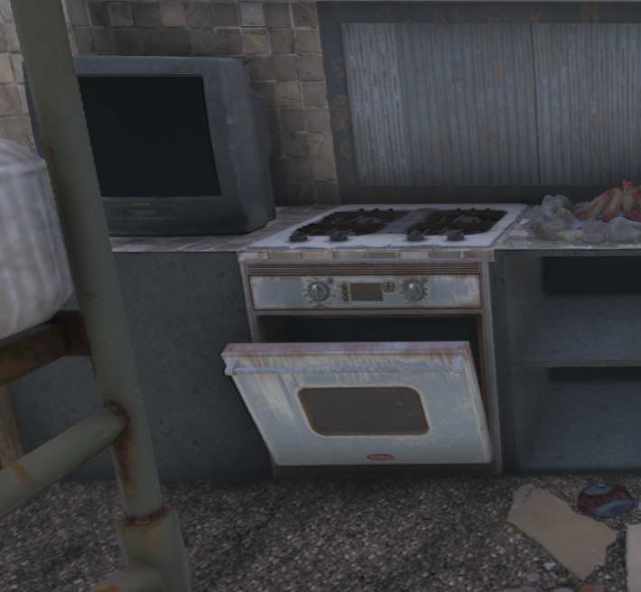

# Functional Gas Stove



Functional Gas Stove turns the vanilla white, grey, and black gas ranges into usable cooking stations. The mod keeps the original models and campfire recipes while applying gas-only fuel rules to these stoves.

## Features

- Converts all three vanilla gas range colors into usable workstations.
- Supports standard campfire recipes and the Cooking Pot, Cooking Grill, and Beaker.
- Allows gas ranges to be picked up and placed elsewhere.
- Includes a craftable white gas range.
- Reuses the campfire recipe-category tabs through Harmony.
- **Gas Cans are the only fuel that powers these stoves.** One Gas Can contributes 300 seconds (five minutes) of burn time. Other combustible items do not contribute burn time to the gas stove.
- Does not change the fuel value of Gas Cans in vanilla campfires, forges, or other workstations.
- Uses the same heatmap values and active radius effect as the vanilla campfire.

## Compatibility

- Designed for **7 Days to Die V3.x.x**.
- The relevant C# method signatures and XML targets were checked against V3.3.0 and V3.4.0 game files.
- Future V3.x updates may require compatibility checks or new patches.
- Requires `0_TFP_Harmony` and **Easy Anti-Cheat (EAC) disabled**.
- **A new world is required. This mod does not work correctly on existing worlds.** Install the mod before generating your world.

## Installation

1. Start a new world after installing the mod. Existing worlds are not supported.
2. Extract the release archive into your game or mod manager's `Mods` folder.
3. Confirm that the final folder structure is:

   ```text
   Mods/
   └── FunctionalGasStove/
       ├── FunctionalGasStove.dll
       ├── ModInfo.xml
       └── Config/
           ├── Localization.csv
           ├── blocks.xml
           ├── recipes.xml
           └── XUi_InGame/
               └── xui.xml
   ```

4. Keep the bundled game's `0_TFP_Harmony` mod enabled and disable EAC.
5. Launch the game, create a **new** world, and test a gas range with a Gas Can.

## Fuel behavior

The fuel restriction is applied only to the mod's three gas stoves by C# Harmony patches. A Gas Can provides 300 seconds per fuel unit. Wood, coal, and other vanilla combustibles yield zero burn time in these stoves. The game UI may still allow placing such items in fuel slots, but they cannot fuel a gas stove. Remove them and use a Gas Can instead.

Other workstations keep their default fuel behavior. Earlier versions of this mod added an extra `FuelValue` property to the Gas Can item globally. That XML patch was removed in v1.0.5.

**When upgrading from v1.0.4:** Remove the obsolete `Config/items.xml` from your source project and from every installed `FunctionalGasStove` folder. Extract the v1.0.5 release into a clean mod folder. Unpacking over an old mod folder without removing legacy files can keep the old global fuel patch active. The build script excludes `Config/items.xml` even if it remains in the source folder.

## Multiplayer

Install the mod on the dedicated server and on all connecting clients, as the C# Harmony patch and custom UI definitions must be available where used. EAC must be disabled. Multiplayer behavior still requires an in-game test on your setup.

## Building from source on Linux

Requirements: .NET SDK 8 or newer for building, the `zip` command, and a local Windows or Linux installation of 7 Days to Die V3.x with managed assemblies and `0_TFP_Harmony`.

If the .NET SDK is not installed, use the included setup script once. It downloads the official Microsoft SDK into `.tools/dotnet/` without sudo. Internet access is required for installation and the first NuGet restore.

Run these commands from the project root:

```bash
./setup-dotnet.sh
./tests.sh
./build.sh v3.4.0
```

If you already have .NET SDK 8 or newer installed, you can skip `./setup-dotnet.sh`. Mono (`mcs`) alone is not sufficient for this project's SDK-based build.

The default game directory is `~/.7dtd_modmanager/game-versions/v3.4.0`. You can pass `v3.3.0`, `latest_experimental`, or a full path to an installation. Alternatively, copy `.env.example` to `.env` and set `SDTD_DIR` there.

A successful build creates `releases/FunctionalGasStove-v1.0.5.zip`. The release archive contains only the installable mod folder. The `releases/` folder itself is excluded, so old releases are never recursively packaged.

## Troubleshooting

- If the mod does not load, verify the correct mod directory, Harmony loader, and EAC settings.
- If an already-generated world contains unusable gas ranges, create a fresh world with the mod enabled.
- If an update changes the game's methods, run `./tests.sh` and rebuild against the correct V3.x game installation.
- If a non-gas item is present in a fuel slot, remove it; it cannot power the stove.
- If the build reports a missing .NET SDK, run `./setup-dotnet.sh`. This only installs build tools, not runtime dependencies for players.
- If `tests.sh` warns about `Config/items.xml`, delete that leftover file after ensuring it contains only the old fuel patch.

## Author

Created by **Paffcio**.

Source: https://github.com/PaffcioStudio/Functional-Gas-Stove
